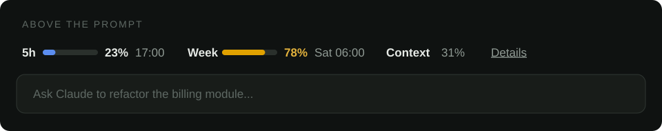
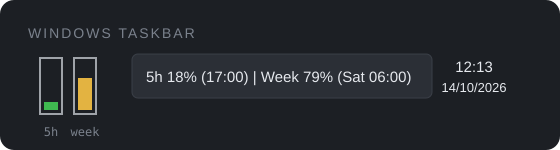
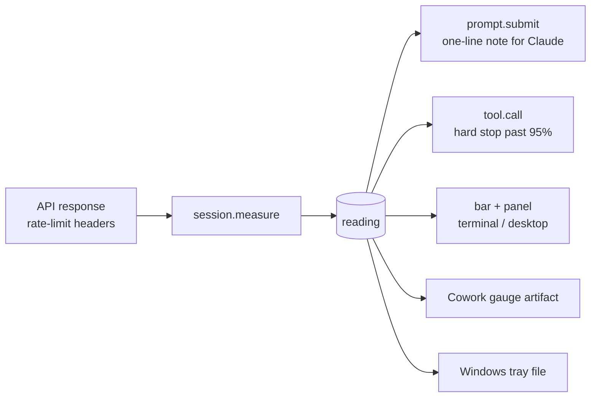

<p align="center">
  
</p>

<p align="center">
  <a href="LICENSE"></a>
  
  
  <a href="README.pt-PT.md"></a>
</p>

<p align="center">
  <a href="https://github.com/LuisPCFialho/claude-fuel-gauge/releases/latest/download/fuel-gauge.plugin"></a>
  <a href="https://github.com/LuisPCFialho/claude-fuel-gauge/releases/latest/download/fuel-gauge-pt.plugin"></a>
</p>

**Stop babysitting your usage.** No more typing "you're at 80%, wrap it up" or watching a long task die at 100% halfway through a refactor.

`fuel-gauge` gives Claude a sense of its own limits. It reads the 5-hour window, the weekly window and the context fill straight from the responses your session already gets. It puts them in front of Claude on every message, draws a small gauge next to your prompt, and pulls a **hard stop at 95%** so work ends at a clean point instead of mid-edit.

## What you get

| | |
|---|---|
| **Claude knows its limits** | Every message carries one short line: `5h 23% (resets 17:00, in 2h10) \| Week 78% (resets Sat 06:00) \| context 31%`. Claude paces heavy work and tells you up front when the margin is short. |
| **A gauge next to your prompt** | Two mini bars above the input (terminal and desktop), coloured by level, with reset times. `/fuel` or **Details** opens a panel. |
| **Hard stop at 95%** | Past the threshold, tool calls (subagents included) and new requests are refused. Claude stops, gives a short summary of what is done and what is left, and goes on only when you start a message with `continue` or press **Unlock 1 request**. The lock lifts by itself when the window resets. |
| **Warnings at 80% and 90%** | A toast for you and a note for Claude, even in the middle of a long turn. |
| **Cowork gauge (optional)** | A live claude.ai artifact with two fuel dials that update after every response. |
| **Windows taskbar icon (optional)** | Two tiny bars next to the clock. Hover for the numbers, double-click for the gauge. |

<p align="center">
  <br>
  
</p>

## Install

In a Claude Code terminal:

```
/plugin install fuel-gauge --marketplace LuisPCFialho/claude-fuel-gauge
```

From a shell:

```
claude plugin install fuel-gauge --marketplace LuisPCFialho/claude-fuel-gauge
```

In Cowork: download [`fuel-gauge.plugin`](https://github.com/LuisPCFialho/claude-fuel-gauge/releases/latest/download/fuel-gauge.plugin) (or the [Portuguese build](https://github.com/LuisPCFialho/claude-fuel-gauge/releases/latest/download/fuel-gauge-pt.plugin)), attach it to a Cowork chat and ask Claude to install it, then press **Install** on the plugin card. It loads in every new Cowork chat of that account.

In the desktop app, where `/plugin` does not run: click **+** next to the prompt box, then **Plugins**, **Add marketplace** with `LuisPCFialho/claude-fuel-gauge`, then **Add plugin**.

Plugin hook modules are early access in Claude Code. `fuel-gauge` was built and tested on Claude Code 2.1.299.

## How it works



The engine already receives your usage windows with every response. `fuel-gauge` listens for those readings (`session.measure`), keeps the latest one and uses it in four places. It never calls the API on its own.

A new chat does not start blind: it picks up the last reading (from this machine, or from the Cowork gauge artifact, which outlives cloud sessions). Windows whose reset time has passed count as 0%, and when the reading is older than 15 minutes Claude is told how old it is, because usage from places without the plugin (claude.ai, mobile) only shows up with the next response.

## What it costs

| Piece | Cost |
|---|---|
| Reading the limits | 0 API calls, 0 tokens |
| Note on each message (`contextLine`) | about 50 input tokens per message; can be turned off |
| Tool description (`limits`) | about 300 tokens, sent with the tool list and served from the prompt cache |
| Bar, panel, warnings, hard stop | 0 tokens |
| Cowork gauge and Windows tray | 0 tokens (one small write per response) |

## Configuration

Set these when you install, or later in the config menu (`pluginConfigs.fuel-gauge.options` in `settings.json`).

| Option | Default | What it does |
|---|---|---|
| `language` | `en` | `en` or `pt` (European Portuguese) for the bar, the panel and the notes Claude reads |
| `lockAt` | `95` | Hard stop threshold, in percent of any window |
| `warnAt` | `80,90` | Warning thresholds |
| `contextLine` | `true` | Send the one-line note with every message |
| `gaugeArtifactUrl` | empty | URL of your Cowork gauge artifact |
| `trayFile` | empty | Where to write `usage.json` for the Windows tray icon |

## Cowork

Cowork has no place for plugins to draw next to the prompt, so the bar does not show there. Claude still knows the limits and the hard stop still works. For something to look at:

1. **Live gauge artifact.** Ask Claude in Cowork: *"Publish `artifact/fuel-gauge.html` from github.com/LuisPCFialho/claude-fuel-gauge as an artifact with the `db` and `user` capabilities, pin it, and set its URL as the fuel-gauge `gaugeArtifactUrl` option."* Each person's readings are private to them.
2. **Windows taskbar icon.** See below. In a cloud session the plugin writes the file through the Windows-MCP connector.

## Windows taskbar icon

```
powershell -ExecutionPolicy Bypass -File tray\windows\install.ps1
```

This copies the script to `%LOCALAPPDATA%\FuelGauge`, adds a Startup shortcut and starts it. Set the path it prints as the `trayFile` option. Windows 11 hides new tray icons behind the **^** arrow: drag the icon to the taskbar once.

Using two Claude accounts (work and personal)? Give each its own icon and file so they never mix:

```
powershell -ExecutionPolicy Bypass -File tray\windows\install.ps1 -Name work
powershell -ExecutionPolicy Bypass -File tray\windows\install.ps1 -Name personal
```

## FAQ

**Does it work with an API key?** API keys have no 5-hour or weekly windows, so you get the context reading only and the hard stop never fires. Gateways that report a `spend_limit` window are shown and enforced like the others.

**Why 95%?** It leaves room for Claude to write a clean summary before the window runs dry. Set `lockAt` to whatever suits you.

**Can Claude get around the stop?** No. The stop sits in the plugin's `tool.call` and `prompt.submit` hooks, outside the model. Only you can unlock it, one request at a time.

**Is this an Anthropic product?** No. It is an independent, unofficial plugin and is not affiliated with or endorsed by Anthropic.

## Develop

```
claude plugin validate .
claude plugin test .
```

Issues and pull requests are welcome. If `fuel-gauge` saved you from a mid-task cut-off, a star helps other people find it.

## License

[MIT](LICENSE) - Luís Fialho ([@LuisPCFialho](https://github.com/LuisPCFialho))
